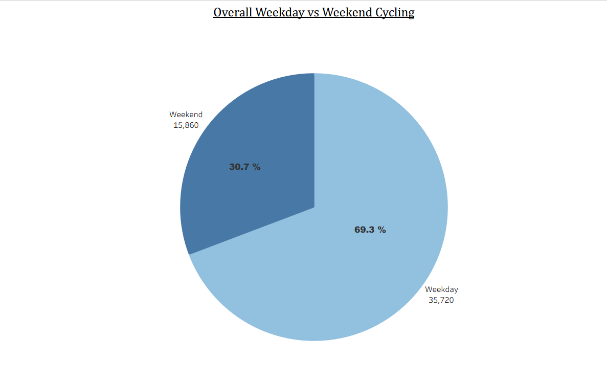
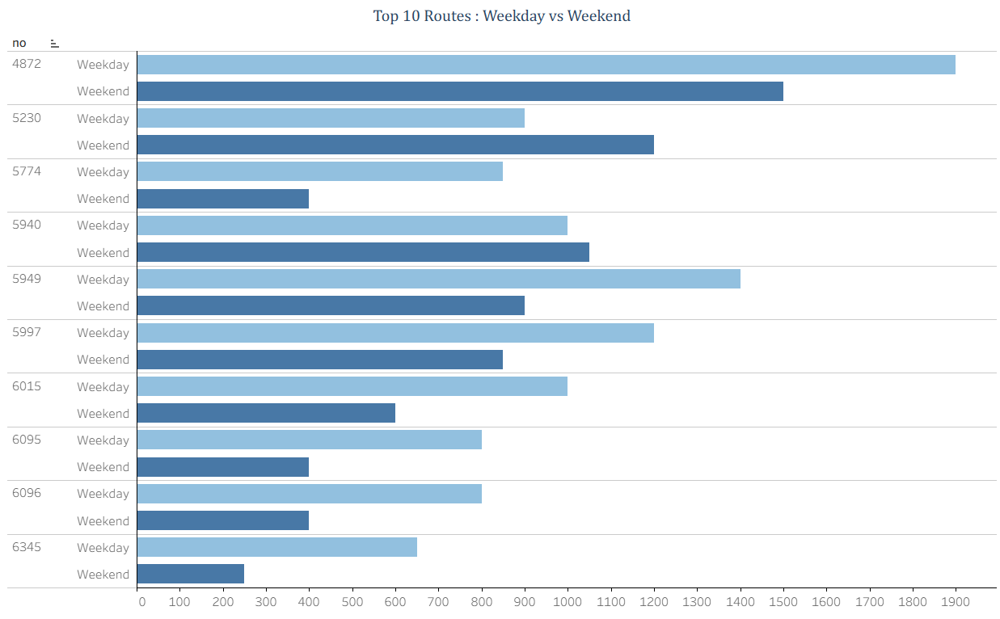
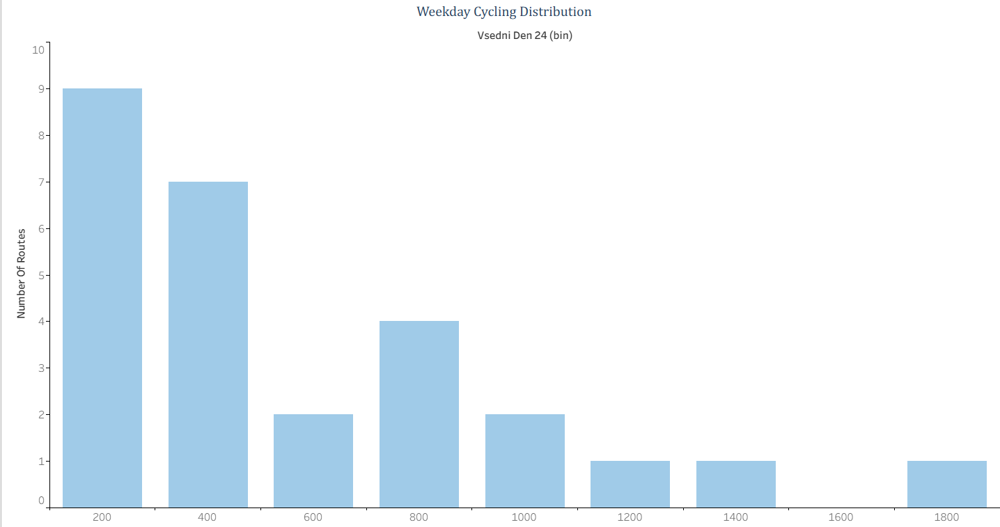
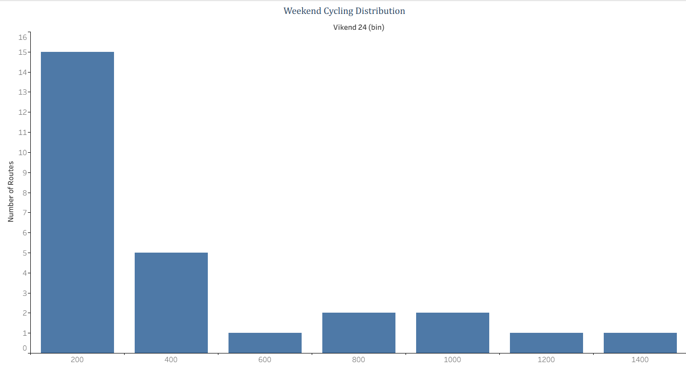
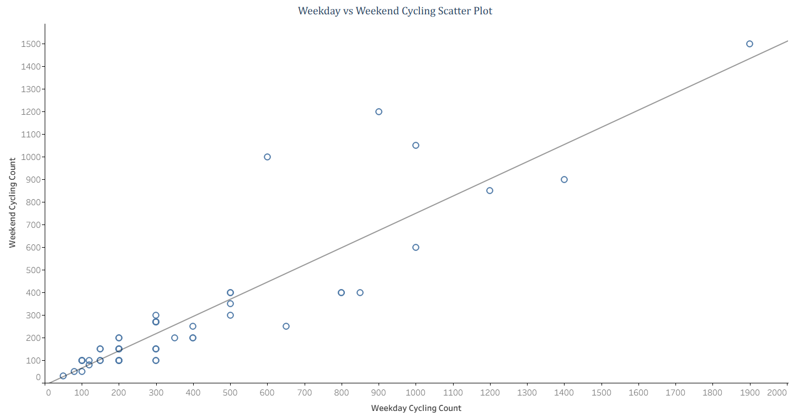
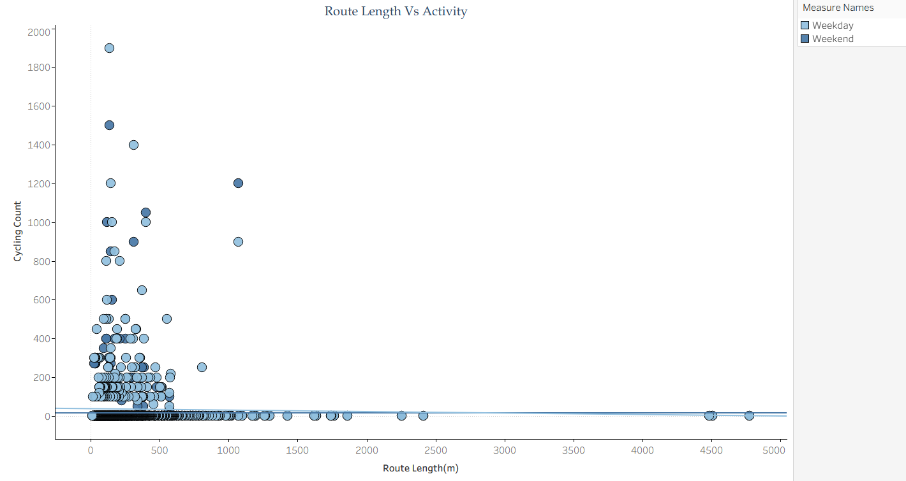
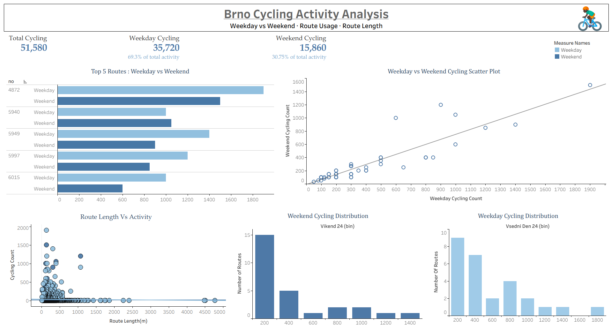

# 🚲 Brno Cycling Analysis | SQL & Tableau

## 📌 Project Overview

This project analyzes cycling intensity across routes in Brno, Czech Republic, using **MySQL and Tableau**. The objective is to explore differences in cycling activity between weekdays and weekends, identify routes with higher cycling counts, and understand variations in cycling patterns across individual routes.

The project follows a data analytics workflow, from data validation and exploratory data analysis using SQL to visualizing patterns and communicating findings through Tableau.

## 🎯 Project Objectives

- Examine data quality by checking for missing values, duplicate records, and data consistency.
- Compare overall weekday and weekend cycling activity.
- Identify the top 10 routes by weekday and weekend cycling counts.
- Investigate route-level differences in cycling intensity.
- Visualize cycling patterns and distributions using Tableau.

## 🛠️ Tools & Technologies

| Tool | Purpose |
|---|---|
| MySQL | Data validation, querying, aggregation, and exploratory data analysis |
| Tableau | Data visualization and dashboard development |
| GitHub | Project documentation and version control |

## 🗃️ Dataset Description

The project uses the `cycling_intensity` dataset, which contains cycling intensity information for routes in Brno.

The main variables used in the analysis are:

| Column | Description |
|---|---|
| `objectid` | Object identifier |
| `no` | Route number |
| `vsedni_den_24` | Weekday cycling count |
| `vikend_24` | Weekend cycling count |
| `datum_exportu` | Data export date |
| `Shape__Length` | Route geometry length attribute |
| `GlobalID` | Global identifier |

## 🔍 SQL Analysis

SQL was used to validate the dataset, explore cycling activity, and calculate summary statistics before creating visualizations.

### 1. Data Quality & Validation

The initial analysis focused on understanding the dataset's structure and checking its reliability. The following checks were performed:

- Inspected column data types using `DESCRIBE`.
- Checked for duplicate records and repeated `objectid` and `GlobalID` values.
- Identified missing values across all columns.
- Examined minimum and maximum weekday and weekend cycling counts.
- Checked whether cycling counts were whole numbers.
- Investigated repeated route numbers and the number of distinct export dates.

### 2. Exploratory Data Analysis (EDA)

Further SQL queries were used to examine overall cycling activity and differences between routes. The analysis included:

- Calculating total and average weekday and weekend cycling counts.
- Measuring the absolute difference between weekday and weekend cycling volumes.
- Calculating the percentage contribution of weekday and weekend counts.
- Identifying the top 10 routes by weekday and weekend cycling counts.
- Comparing weekday and weekend counts for individual routes.
- Identifying routes with higher weekday or weekend activity.
- Calculating relative differences between weekday and weekend cycling counts.

## 📊 Tableau Visualizations

The results of the SQL analysis were explored through Tableau visualizations designed to make cycling patterns easier to compare and interpret.

| Visualization | Purpose |
|---|---|
|Overall Weekday vs. Weekend Cycling|	Compares the overall contribution of weekday and weekend cycling activity.|
|Top 10 Routes by Weekday Cycling|	Compares weekday and weekend counts for the ten routes with the highest weekday cycling counts.|
|Weekday Cycling Distribution|	Examines the distribution of weekday cycling counts across routes.|
|Weekend Cycling Distribution|	Examines the distribution of weekend cycling counts across routes.|
|Weekday vs. Weekend Cycling Scatter Plot|	Explores the relationship between weekday and weekend cycling counts for individual routes.|
|Route Length vs. Activity	|Investigates the relationship between route length and cycling intensity.|

## 💡 Key Findings

The analysis aims to identify meaningful differences in cycling activity across weekdays, weekends, and individual routes. The final findings will be based on the SQL query results and Tableau visualizations.
## Key Visualizations

### 1. Overall Weekday vs. Weekend Cycling

### 2. Top 10 Routes by Weekday Cycling

### 3. Weekday Cycling Distribution

### 4. Weekend Cycling Distribution

### 5. Weekday vs. Weekend Cycling Scatter Plot

### 6. Route Length vs. Cycling Activity

## Tableau Dashboard

## 📊 Data Source

The dataset was obtained from the official open-data catalog for Brno's bike traffic intensity data.

- **Source:** [Data.Brno](https://data.brno.cz/datasets/d1da67e9d3b5429c935929021278e0d4_0/explore?location=49.160998%2C16.651662%2C9)
- **Publisher:** City of Brno
- **Data used:** Intenzita cyklistů 2024

## 👤 Author

**Zaina Khanum**

SQL | Tableau | Data Visualization

[Connect with me on LinkedIn](https://www.linkedin.com/in/zaina-khanum)

